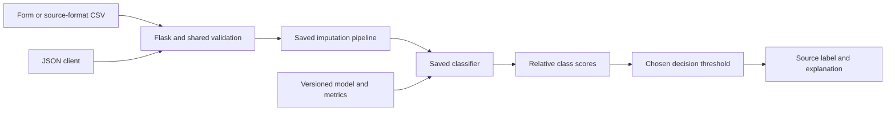
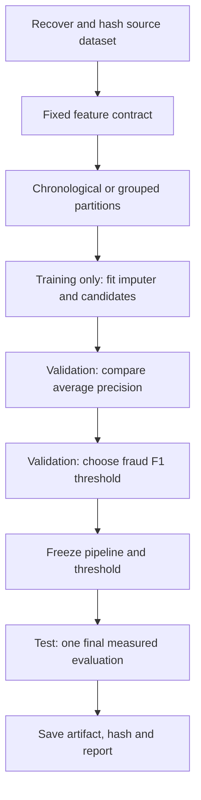
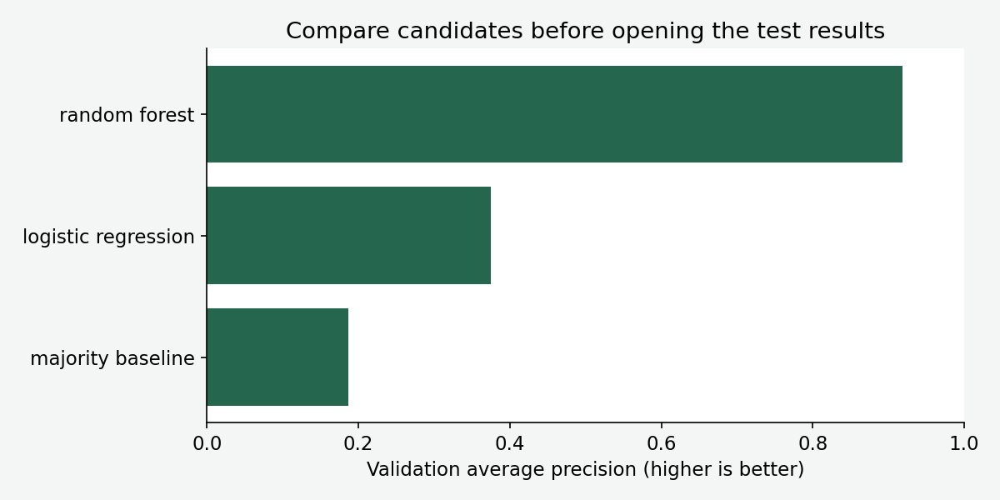
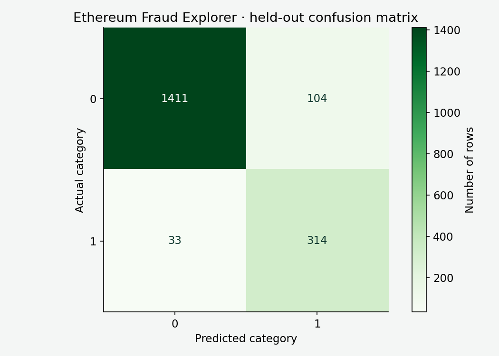
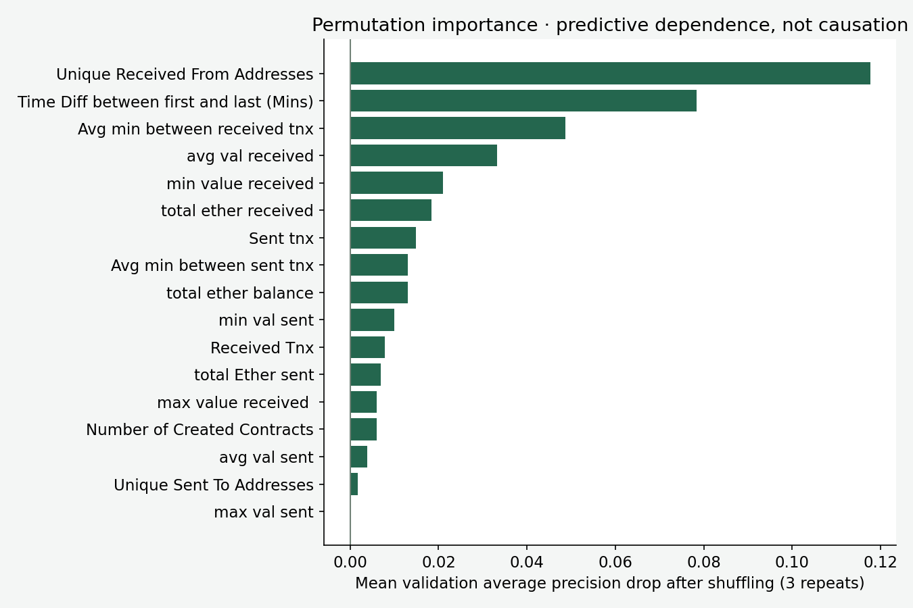
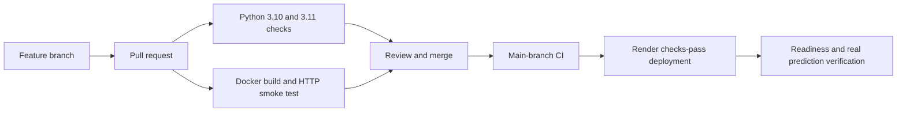

# Ethereum Fraud Explorer

An end-to-end **historical fraud-classification learning app**: Flask UI, JSON API, bounded CSV scoring, threshold exploration, reproducible training, measured evaluation, Docker and CI/CD.

The source contains 9,841 Ethereum account-summary rows and a binary `FLAG`. The app uses 17 fixed numeric behavioral summaries, excluding addresses, row IDs, token names and the outcome. It does not fetch live blockchain data or inspect a wallet address. Observed account histories can include information accumulated after a useful early-warning time; that timing is undocumented.

> Educational research demonstration. A source fraud label or model result is not proof of wrongdoing. Scores are uncalibrated; do not use this app to block payments, accuse wallet owners or make financial decisions. Use synthetic examples and never upload private financial information.

[Run locally](#run-locally) · [Use the application](#use-the-application) · [Training](#training-and-model-selection) · [Measured results](#measured-results) · [Deployment](#deployment-on-render)

## Problem statement

The supervised binary task predicts the source label: `0` means non-fraud and `1` means fraud. Real fraud is often rare, and the cost of a false alarm differs from the cost of a missed fraud. Therefore, a useful evaluation needs ranking metrics, per-class precision/recall and a clear threshold, rather than a headline accuracy number alone.

The app demonstrates those concepts using historical data. It supports a synthetic form example, all required source-format numeric fields, CSV batch scoring, a JSON endpoint, measured model results and readiness/version checks. Original notebooks and reports remain available; the archived README preserves their original description. The web app trains a new reviewed pipeline rather than trusting an old serialized model.

## Architecture



The prediction service is a class because it owns a loaded model and report reused across requests. Input validation and metric calculation are functions. Training is an offline script; web requests never retrain. The exact preprocessing is serialized with the estimator, avoiding a different feature order or imputation rule at prediction time.

## Run locally

Use Python 3.10 or 3.11 and the pinned scikit-learn 1.6.1 environment.

```bash
git clone https://github.com/subhashdixit/ethereum-fraud-detector.git
cd ethereum-fraud-detector
python3 -m venv .venv
source .venv/bin/activate
python -m pip install --upgrade pip
pip install -r requirements-dev.txt
pip install --no-deps -e .
python -m pip check
flask --app wsgi:app run --host 127.0.0.1 --port 8000
```

On Windows, activate with `.venv\Scripts\Activate.ps1`; use Flask locally or Docker for a Linux production runtime. Open [http://127.0.0.1:8000](http://127.0.0.1:8000). The reviewed model is committed, so the application works without downloading raw data or retraining.

For production-style local serving on Linux/macOS:

```bash
gunicorn --config gunicorn.conf.py wsgi:app
python scripts/smoke_test.py --url http://127.0.0.1:8000 --attempts 3
```

`PORT` sets the listening port; `MODEL_DIR` can select a trusted matching model/report/sample directory. Run commands from the repository root.

## Use the application

1. Start with the synthetic profile, formed from training medians. It is not a labeled real transaction, so there is no promised correct category for this artificial combination.
2. Enter numeric source features with the documented meanings. Blank cells or JSON `null` use the fitted training imputer. Zero is an observed value, not missing.
3. Choose a fraud threshold between 0.01 and 0.99. The initial threshold is **0.31**, selected using validation fraud F1.
4. Submit and read the category and both class scores. Lowering the threshold normally flags more rows; it does not make the underlying scores more accurate.
5. Download the sample CSV, keep the headers, add up to 500 rows and upload it. Batch output includes row numbers, labels and scores; it does not echo identifiers or arbitrary user strings.
6. Inspect the model card and full JSON metrics. Published evaluation uses the frozen default threshold; experimenting in the form does not rewrite those metrics.

The maximum request body is 1 MiB. Missing required columns, invalid/non-finite values, impossible numeric ranges and entirely missing rows fail explicitly. Extra columns are ignored. Broad bounds are sanity checks, not an out-of-distribution detector. Application code does not persist uploads; hosting infrastructure can still retain routine request metadata.

### Input dictionary

| Source field | Meaning |
|---|---|
| `Avg min between sent tnx` | Average minutes between sent transactions |
| `Avg min between received tnx` | Average minutes between received transactions |
| `Time Diff between first and last (Mins)` | Observed account lifetime (minutes) |
| `Sent tnx` | Sent transaction count |
| `Received Tnx` | Received transaction count |
| `Number of Created Contracts` | Created contracts |
| `Unique Received From Addresses` | Unique incoming addresses |
| `Unique Sent To Addresses` | Unique outgoing addresses |
| `min value received` | Minimum received value |
| `max value received ` | Maximum received value |
| `avg val received` | Average received value |
| `min val sent` | Minimum sent value |
| `max val sent` | Maximum sent value |
| `avg val sent` | Average sent value |
| `total Ether sent` | Total ETH sent |
| `total ether received` | Total ETH received |
| `total ether balance` | Net ETH balance |

CSV header spelling is exact, including the trailing space in `max value received `. Start with the downloaded sample to avoid silently changing that source name. The account-summary observation horizon and aggregation boundaries must match the source; the app does not calculate them from an address.

## JSON and CSV API

| Route | Purpose |
|---|---|
| `GET /` | Browser application |
| `POST /predict` | HTML form |
| `POST /api/predict` | JSON `records` list and optional `threshold` |
| `GET /sample.csv` | Synthetic source-format example |
| `POST /predict-csv` | Multipart `file` and optional `threshold` |
| `GET /api/metrics` | Model version, data hash and evaluation |
| `GET /health/ready` | Readiness and deployed Git revision |

```bash
python -c 'import json; from pathlib import Path; x=json.loads(Path("models/sample.json").read_text()); Path("request.json").write_text(json.dumps({"records":[x],"threshold":0.31}))'
curl -X POST http://127.0.0.1:8000/api/predict \
  -H 'Content-Type: application/json' --data-binary @request.json
curl http://127.0.0.1:8000/sample.csv -o sample.csv
curl -X POST http://127.0.0.1:8000/predict-csv \
  -F 'file=@sample.csv' -F 'threshold=0.31' -o predictions.csv
```

Each prediction contains `category` (`"0"` or `"1"`), a description and scores for both classes. The response includes model version. A positive label means score for class 1 is at least the chosen threshold. Scores are rounded to six decimals; decisions use unrounded model outputs.

Bad input returns 400, oversized bodies 413, missing routes 404 and unexpected failures 500 with a generic response. The service has no authentication or per-user rate limiter; public-demo limits do not make it a production payment API.

## Source data and reproducibility

Original dataset: [https://www.kaggle.com/datasets/vagifa/ethereum-frauddetection-dataset](https://www.kaggle.com/datasets/vagifa/ethereum-frauddetection-dataset). Raw records are excluded from Git and the Docker image. The reviewed pipeline, metrics and a synthetic example are included.

Download the source and verify the recorded training hash:

```bash
python scripts/download_data.py
python scripts/train.py
python scripts/plot_results.py
# Train a candidate without replacing reviewed artifacts:
python scripts/train.py --output-dir /tmp/fraud-candidate
```

The downloader uses the original Kaggle public endpoint, extracts only the configured CSV, bounds its size and checks its SHA-256 against the reviewed report. If Kaggle requires authentication or changes its download response, obtain the dataset from the linked source page and place `transaction_dataset.csv` under `data/`. Do not substitute a synthetic dataset and describe its metrics as the original benchmark.

The downloaded source has **9,841 rows**. Consult the dataset page for its license, terms, provenance and attribution; repository code licensing does not automatically license a third-party dataset. Data hashes establish the exact input bytes, not data ownership or label validity.

## Training and model selection

GroupShuffleSplit assigns identical selected numeric feature vectors to the same partition, using seeds 42 and 43. Actual row fractions vary with group size. Addresses are excluded from model inputs. Grouping by input values does not establish independence among related wallets, scam campaigns or collection sources. Future-period and independently sourced validation remain necessary.

| Partition | Rows | Class 0 | Class 1 |
|---|---:|---:|---:|
| train | 6,107 | 4,624 | 1,483 |
| validation | 1,872 | 1,523 | 349 |
| test | 1,862 | 1,515 | 347 |



Only training rows fit median imputation, missing indicators, scaling and estimators. There is no SMOTE or global oversampling. Balanced class weights increase training emphasis on rare fraud, without copying examples across partitions. Weighting can distort the interpretation of probabilities, so scores are explicitly uncalibrated.

| Model | Mechanism | Strength | Limitation |
|---|---|---|---|
| Majority baseline | Always choose the common source label | Makes imbalance visible | Misses every fraud when non-fraud is the majority |
| Logistic regression | Regularized linear log-odds model with scaling | Compact, fast baseline; learns ranked scores | Limited nonlinear interactions, sensitive to representation and calibration |
| Random forest | 120 randomized trees, depth 14, minimum leaf size 2 | Learns nonlinear interactions | Larger artifact, less transparent predictions, imperfect extrapolation |

All three use fitted median imputation and missingness indicators. Logistic regression also uses standard scaling and balanced weights. The forest uses balanced-subsample weights and seed 42. These fixed candidates demonstrate comparison; this is not an exhaustive search across every algorithm.

Candidates are selected by **validation average precision**, a threshold-free ranking summary. For the selected model only, thresholds 0.01 through 0.99 in steps of 0.01 are compared by validation fraud F1. The test partition is not used to choose either model or threshold. A boundary winner such as 0.99 means best within this grid, not proof of a global optimum or appropriate business policy.

| Validation candidate, threshold 0.50 | Average precision | Accuracy | Macro F1 |
|---|---:|---:|---:|
| majority baseline | 0.186 | 81.36% | 0.449 |
| logistic regression | 0.375 | 72.60% | 0.667 |
| random forest | 0.919 | 93.59% | 0.890 |



Selected model: **random forest**, deployed threshold **0.31**. Candidate threshold-0.50 metrics and final threshold metrics are distinct and both are retained in `models/metrics.json`.

## Measured results

| Held-out test metric, default threshold | Result |
|---|---:|
| Test rows | 1,862 |
| Average precision | 0.928 |
| ROC AUC | 0.976 |
| Accuracy | 92.64% |
| Macro F1 | 0.887 |
| Fraud precision | 0.751 |
| Fraud recall | 0.905 |
| Fraud F1 | 0.821 |

| Class | Precision | Recall | F1 | Support |
|---|---:|---:|---:|---:|
| 0 | 0.977 | 0.931 | 0.954 | 1,515 |
| 1 | 0.751 | 0.905 | 0.821 | 347 |



Rows are actual labels and columns are predictions: **1,411 true negatives**, **104 false alarms**, **33 missed frauds**, **314 detected frauds**.

**Precision** answers how many flags are correct: `314/(314+104) = 0.751`. **Recall** answers how many frauds are detected: `314/(314+33) = 0.905`. Raising the threshold usually reduces flags, potentially improving precision while losing recall. The appropriate tradeoff depends on review capacity and error costs; an F1-selected demonstration threshold does not encode those costs.

**F1** is `2PR/(P+R)`. It balances precision and recall but ignores true negatives and does not represent monetary loss. **Macro F1** averages the two class F1 values equally. **Weighted F1** weights by support and can hide minority weakness.

**Average precision (AP)** summarizes precision across recall changes. It is useful when positives are rare and ranking quality matters. Its baseline depends on prevalence, and AP values across datasets with different fraud rates are not directly interchangeable. AP is not exactly the same calculation as trapezoidal area under a precision-recall curve.

**ROC AUC** measures ranking discrimination across false-positive/true-positive tradeoffs. It can look strong even when a small false-positive rate produces many alerts among numerous negatives. Inspect precision, recall and absolute counts alongside AUC.

**Accuracy** counts every correct label equally. The test majority-only accuracy is **1,515/1,862 = 81.36%**. Compare that baseline before celebrating the model's accuracy. No current real-world fraud-prevention performance is established by this historical holdout.

### Feature importance



The chart shuffles one validation field and measures the AP drop, averaged over three repeats on at most 3,000 validation rows. With few fraud examples, importance can be noisy; correlated features can share importance. This is global predictive dependence, not causation or an explanation of one flagged person. The chart does not establish that changing a feature would prevent fraud.

## Testing and code quality

```bash
python -m black --check src tests scripts wsgi.py gunicorn.conf.py
python -m pylint src scripts wsgi.py gunicorn.conf.py
python -m pytest -q
python -m pip check
```

Tests exercise real saved-model inference, single/batch parity, API/form/CSV consistency, reordered columns, ignored identifiers, missing values, bad numeric input, invalid category values, decision thresholds, model hash mismatch, upload limits, security headers, readiness, metric totals and HTTP errors.

A checksum detects accidental artifact mismatch, not malicious changes to both the model and report. Joblib models must come from a trusted reviewed source because loading pickle-based formats can execute code. Never deserialize user-uploaded artifacts.

Browser checks complement unit tests: the page must render, the example form must produce a result, the matrix must be readable and the mobile layout must remain usable. Passing lint does not prove that the ML assumptions are correct; evaluation and data audits are separate work.

## CI/CD: what happens after a change



**CI**, continuous integration, checks whether changes remain compatible. The workflow installs pinned dependencies, checks formatting and Pylint, runs tests and builds a Docker image. Its container job starts the image and sends a real HTTP prediction. This catches missing files and packaging mistakes that an in-process test alone can miss.

**CD**, continuous deployment, publishes an accepted revision to hosting. Render must be configured to deploy **after CI checks pass**, matching `render.yaml`. Merely committing that YAML does not activate a service; the hosting service has to be connected or created from the blueprint.

Benefits include repeatability, early error detection and traceable releases. Costs include build time, dependency maintenance and platform configuration. Passing tests does not guarantee good predictions, so model evaluation and release review remain necessary. The included CI does not automatically retrain or promote new models.

## Docker: what it adds

Docker packages the Python runtime, application, dependencies and reviewed model into an image. A running container is an instance of that image. It helps a developer and CI use a similar environment, even when the developer's laptop runs a different operating system.

```bash
docker build -t patient-ethereum_fraud:local .
docker run --rm -p 8000:8000 --read-only --tmpfs /tmp patient-ethereum_fraud:local
python scripts/smoke_test.py --url http://127.0.0.1:8000 --attempts 3
```

The container runs as a non-root user and excludes raw workbooks from the image. It contains the saved pipeline, not a training job. `--read-only` prevents application writes except under the temporary directory.

Docker improves packaging consistency but adds image size, build time and another layer to maintain. It is not a virtual machine, automatic security guarantee or mandatory requirement for Flask. This project uses **Docker on Render**, so CI and hosting build the same image definition. The image contains the reviewed fraud model and excludes raw source CSVs.

## Deployment on Render

**Hosting** provides the computer and public endpoint where an app runs. **Deployment** installs a particular application version into that environment. Render is the hosting platform; GitHub stores the source; GitHub Actions runs quality checks; Gunicorn serves Flask requests.

Create a free **Web Service** connected to this repository and `main`, using Docker, or create the supplied blueprint.

| Setting | Value |
|---|---|
| Runtime | Docker |
| Plan | Free |
| Dockerfile | `./Dockerfile` |
| Health check | `/health/ready` |
| Auto deploy | After CI checks pass |

The Docker image specifies Python 3.11 and numerical thread limits. No separate Render build/start commands are needed: the Dockerfile installs the app and starts Gunicorn.

Render supplies `PORT`. Gunicorn binds to `0.0.0.0:$PORT` with one worker and two threads. The small worker count avoids loading several independent copies of the model on a small instance. Heavy training runs outside the web process.

After deployment, verify readiness and an actual prediction:

```bash
python scripts/smoke_test.py --url https://YOUR-SERVICE.onrender.com \
  --expected-revision YOUR_DEPLOYED_GIT_SHA --attempts 12
```

A service being marked live only proves that it started. The prediction check verifies that the model, sample, routes and deployed source revision work together. Check the form in a browser as well.

Render's free services sleep after 15 idle minutes and can take about a minute to wake. Free web services share 750 running hours per workspace per calendar month; other portfolio apps consume the same allowance. Local files are ephemeral. Bandwidth and build limits are separate. This application uses no database and stores no user uploads. A free demo is not an always-on production availability promise. See [Render free-service documentation](https://render.com/docs/free).

## Versioning, retraining and rollback

There are several separate versions:

- **Git commit:** identifies code, configuration and committed artifacts.
- **Model version:** `1.0.0` in the report identifies the reviewed model release.
- **Dependency versions:** pinned Python libraries define the compatible runtime.
- **Data hashes:** identify the exact workbook bytes used in training.

Retraining changes learned parameters. Deployment changes the serving release. You can deploy a documentation fix without retraining, and you can train a candidate without deploying it.

For a model update, train into a candidate directory, compare validation behavior and limitations, run compatibility tests, update the model/report/sample as one unit, review the change and deploy. Keep the previous artifact available. If the test set guides repeated tuning, it is no longer untouched; reserve a fresh evaluation period or external set before making stronger claims.

For rollback, prefer reverting the problematic merge through a reviewed Git commit and allowing CI/CD to publish the restored code **and matching model/report**. Render also offers rollback to a limited number of previous deploys on its free plan. A manual hosting rollback does not revert GitHub; reconcile the source branch so the next deployment does not reintroduce the problem. See [Render deploy documentation](https://render.com/docs/deploys).

Rollback improves recovery time but cannot undo already consumed outputs, and model/schema changes can break compatibility. That is why the artifact hash, feature contract, version and smoke checks travel together.

## Repository structure

```text
src/ethereum_fraud/           schema, service, Flask routes, templates and styling
scripts/download_data.py    original-source download and hash verification
scripts/train.py            reproducible model and threshold selection
scripts/plot_results.py     measured evaluation figures
scripts/smoke_test.py       readiness and real HTTP prediction check
configs/project.json       fixed source and feature configuration
models/                    reviewed pipeline, report and synthetic example
tests/                     validation, threshold, API, CSV and artifact tests
data/                      local-only raw dataset, ignored by Git
archive/                   original README
Dockerfile                 non-root portable serving image
render.yaml                free Docker deployment configuration
.github/workflows/ci.yml   Python checks and container smoke test
```

## Troubleshooting and responsible interpretation

Run from the repository root or set `MODEL_DIR` explicitly. Restore matching trusted model/report files if their hashes disagree; never edit the hash merely to silence the check. Keep the pinned scikit-learn version. If CSV headers fail, use the downloaded sample. For free-host cold starts, allow time to wake and inspect logs if readiness remains unavailable.

A high model score is not evidence sufficient to accuse an individual or block a transaction. This demonstration has no production incident response, appeal process, fraud-label feedback, drift alerts or independent external validation. Monitor model and data drift separately from server uptime if extending the project. Do not log private transaction profiles.

## Further reading

- [Original dataset](https://www.kaggle.com/datasets/vagifa/ethereum-frauddetection-dataset)
- [Scikit-learn preprocessing and leakage](https://scikit-learn.org/stable/common_pitfalls.html)
- [Classification and ranking metrics](https://scikit-learn.org/stable/modules/model_evaluation.html)
- [Model persistence security](https://scikit-learn.org/stable/model_persistence.html)
- [Render Docker deployment](https://render.com/docs/docker)
